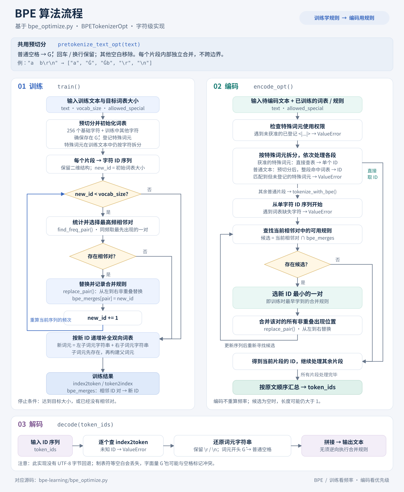

# BPE 分词器：`bpe_optimize.py`

`BPETokenizerOpt` 是一个用于学习的 BPE（Byte Pair Encoding）实现。它从**字符序列**出发，反复合并最高频的相邻词元对，得到词表和合并规则；编码时复用这些规则，将新文本转换为词元 ID。

虽然算法名包含 Byte，这份代码并未先把文本转换为 UTF-8 字节。它使用 Python 字符串中的 Unicode 字符作为初始单位，预置 U+0000～U+00FF，并补充训练文本中出现的其他字符。

## 算法流程图



图中的函数名与源码对应。训练关注“哪一对出现最多”，编码关注“哪条规则最早学到”。图片放在本目录的 `assets/`，因为它只服务于 `bpe-learning` 的说明，不需要放到整个仓库的根目录。

需要位图时，可使用同内容的 [PNG 版本](assets/bpe-flowchart.png)。

## 核心数据结构

| 属性 | 内容 | 示例 |
| --- | --- | --- |
| `index2token` | 词元 ID → 词元字符串 | `258: "bc"` |
| `token2index` | 词元字符串 → 词元 ID | `"bc": 258` |
| `bpe_merges` | 相邻词元 ID 对 → 合并后的新 ID | `(98, 99): 258` |

新 ID 随训练轮次递增，因此 `bpe_merges[pair]` 同时表示合并结果和合并优先级：**ID 越小，规则越早学到，编码时越先使用**。示例中的具体 ID 取决于初始词表和特殊词元配置。

## 1. 预切分：`pretokenize_text_opt`

训练和普通文本编码共用这一过程：

1. 用 `re.split(r"([\r\n])", text)` 拆分文本，保留每个回车和换行。
2. 对其他片段处理空白，将普通空格转换为空格标记 `Ġ`，再调用 `split()`。
3. 返回片段列表；后续统计和合并都不跨越片段边界。

```python
BPETokenizerOpt.pretokenize_text_opt("a  b\r\n")
# ["a", "Ġ", "Ġb", "\r", "\n"]
```

一个空格可以附在后面的文本片段上，多余空格和末尾空格形成独立的 `Ġ`。`Ġb` 内部可以合并；`"a"` 与下一个片段之间不能合并。标点不单独切开，例如 `"hello,world"` 是一个片段。

## 2. 训练：`train`

调用形式：

```python
bpe.train(text, vocab_size=1_000, allowed_special={"<|endoftext|>"})
```

训练步骤如下：

1. **预切分文本。** 得到普通文本、空格标记和换行片段。
2. **初始化词表。** 先加入 256 个基础字符，再加入训练片段中的其他字符，确保包含 `Ġ`，最后登记特殊词元。
3. **转成二维 ID 序列。** 每个片段对应一个字符 ID 列表，外层列表保留合并边界。
4. **学习合并规则。** 从初始词表大小开始分配新 ID，最多分配到 `vocab_size - 1`：
   - `find_freq_pair()` 用 `Counter` 统计各片段内部相邻 ID 对的总频次。
   - 选择最高频的一对；频次相同时选择遍历中最先出现的一对。
   - 若没有相邻对，提前结束。
   - `replace_pair()` 从左到右替换该对的所有非重叠出现位置。
   - 将 `(左 ID, 右 ID) -> 新 ID` 写入 `bpe_merges`，继续下一轮。
5. **补全词表。** 按新 ID 递增遍历合并规则，将两个子词元字符串拼接成新词元，写入双向词表。

频次统计包含重叠的相邻位置，但替换不重叠。例如 `"aaa"` 中 `(a, a)` 的统计频次为 2，一轮替换后得到 `[aa, a]`。

`vocab_size` 是目标大小，不保证实际达到：没有可合并的相邻对时会提前停止；若它小于初始词表大小，代码不会裁剪初始词表，也不会执行合并轮次。

## 3. 编码：`encode_opt` 与 `tokenize_with_bpe`

`encode_opt()` 负责处理完整文本：

1. 检查文本中是否包含词表已登记、形如 `<|...|>`、但本次未获准使用的特殊词元；有则抛出 `ValueError`。
2. 按获准的特殊词元切分文本，长字符串优先匹配。特殊词元直接查表得到单个 ID；若匹配到的特殊词元未登记，抛出 `ValueError`。
3. 对普通文本预切分。若整个片段已在词表中，直接取 ID；否则调用 `tokenize_with_bpe()`。
4. 按原文顺序汇总各段的 ID。

`tokenize_with_bpe()` 处理一个普通片段：

1. 将片段拆成字符 ID；发现词表缺失的字符时抛出 `ValueError`。
2. 在当前相邻 ID 对中，找出存在于 `bpe_merges` 的候选。
3. 选择合并结果 ID 最小的候选，即训练时最早学到的规则。
4. 从左到右替换该对的所有非重叠出现位置，再重新查找候选。
5. 没有可用规则或序列长度不超过 1 时返回。

**编码阶段不重新统计词频，也不是遇到第一个可合并位置就立即合并。**

### 为什么要遵循合并优先级？

```python
from bpe_optimize import BPETokenizerOpt

bpe = BPETokenizerOpt()
bpe.train("bc\nbc\nab", vocab_size=260)

print(bpe.bpe_merges)
# {(98, 99): 258, (97, 98): 259}

ids = bpe.encode_opt("abc")
print(ids)                               # [97, 258]
print([bpe.index2token[i] for i in ids])   # ["a", "bc"]
print(bpe.decode(ids))                    # abc
```

此例中，初始词表有 258 项：256 个基础字符、`Ġ` 和默认特殊词元。`bc` 出现 2 次，先学到 `b + c -> 258`；随后学到 `a + b -> 259`。编码 `abc` 时，两条规则都能匹配，但必须先使用 `bc`，因此结果为 `[a, bc]`。单纯从左向右优先合并会错误地得到 `[ab, c]`。

## 4. 解码：`decode`

解码逐个检查 ID 并查 `index2token`：

- 未知 ID：抛出 `ValueError`。
- `\r`、`\n`：原样保留。
- 以 `Ġ` 开头的词元：把开头的 `Ġ` 还原为一个普通空格。
- 其他词元：原样输出。

最后拼接字符串，无须反向逐条撤销合并规则。

## 使用示例

在本目录、已激活的 Python 环境中运行以下代码即可；实现仅依赖 Python 标准库。

```python
from bpe_optimize import BPETokenizerOpt

text = "温柔的海风  吹到山峰\r\n温柔的海风"
bpe = BPETokenizerOpt()
bpe.train(text, vocab_size=300)

ids = bpe.encode_opt(text)
assert bpe.decode(ids) == text

special_text = text + "<|endoftext|>"
special_ids = bpe.encode_opt(
    special_text,
    allowed_special={"<|endoftext|>"},
)
assert bpe.decode(special_ids) == special_text
```

直接运行 `bpe_optimize.py` 只会执行文件末尾的中文文本训练示例，当前没有打印输出。

## 实现特点与边界

| 方面 | 当前行为 |
| --- | --- |
| 训练次数 | 每个实例应只训练一次。`train()` 没有清空已有的 `bpe_merges`，也没有阻止第二次调用；重新训练应创建新实例。 |
| 字符覆盖 | 基础字符和训练中补充的字符可用；编码遇到未收录的 Unicode 字符会报错，没有未知词元或 UTF-8 字节回退。 |
| 空白保真 | 保留普通空格、回车和换行；制表符等其他空白会被移除。例如 `"a\tb"` 编码后解码为 `"ab"`。 |
| 空格标记 | `Ġ` 兼作内部空格标记，未做字面量转义。原文自身包含 `Ġ` 时可能无法精确还原，例如单独的 `"Ġ"` 会解码为空格。 |
| 特殊词元 | 训练时只登记词表，不把训练文本中的特殊词元整体隔离；特殊词元的单独识别发生在编码阶段。编码默认不允许已登记的 `<|...|>` 特殊词元。 |
| ID 可复现性 | 多个特殊词元以集合传入时，遍历顺序可能不同，因此特殊词元的 ID 不应假定固定。 |
| 性能 | 使用 `Counter` 统计、`deque` 顺序替换，并让训练和编码复用替换函数；训练每轮仍全量重算频次，编码每轮仍扫描候选，没有增量频次索引或堆。 |

设预切分后初始字符 ID 总数为 `N`，实际训练合并轮数为 `M`，训练的统计与替换主循环最坏为 `O(MN)`。对长度为 `L` 的单个片段，编码最多进行 `L - 1` 轮合并，每轮扫描当前序列，最坏为 `O(L²)`。这两个估计描述合并循环，不包含正则处理和词表字符串构建成本。

## 文件布局

```text
bpe-learning/
├── bpe_optimize.py
├── readme.md
└── assets/
    ├── bpe-flowchart.svg
    └── bpe-flowchart.png
```

SVG 是可缩放的矢量图片，可在浏览器中单独打开，也便于后续跟随源码更新。
